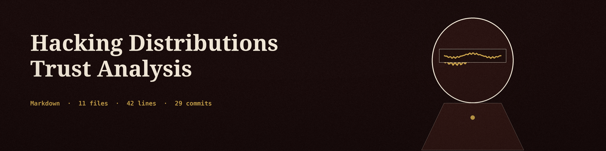

# Hacking Linux Distributions Trust Analysis

## Overview

This repository contains PDF research reports that analyze the trustworthiness of several hacking and penetration testing distributions. The reports consider developer identity and history, development practices, security history, community perception, and mechanisms for verifying distribution integrity.

## Why I did this research

I wrote these reports because I had to pick a hacking distribution for my own setup, and I did not want to pick on reputation alone. Each report asks the same questions about a different distribution: who makes it, can I verify what I download, and what has gone wrong before. The recommendation section at the end is where I landed for my own machines. It is my opinion, and it is not part of the reports themselves.

## Contents

All seven PDFs in this repository are listed below. Page counts and text layer status were verified with pdfinfo and pdftotext on 2026-10-30.

| Report | Pages | Text layer |
| --- | --- | --- |
| [Athena OS Developer Trust Analysis.pdf](./Athena%20OS%20Developer%20Trust%20Analysis.pdf) | 10 | Yes, extractable text |
| [BlackArch Developer Trust Analysis.pdf](./BlackArch%20Developer%20Trust%20Analysis.pdf) | 14 | Yes, extractable text |
| [CommandoVM_Analysis.pdf](./CommandoVM_Analysis.pdf) | 5 | No, image only pages (see note below) |
| [Kali Linux Developer Trust Analysis.pdf](./Kali%20Linux%20Developer%20Trust%20Analysis.pdf) | 18 | Yes, extractable text |
| [Linux Hacking Distro Research.pdf](./Linux%20Hacking%20Distro%20Research.pdf) | 16 | Yes, extractable text, overview covering multiple distributions |
| [ParrotOS Trust and Developer Research.pdf](./ParrotOS%20Trust%20and%20Developer%20Research.pdf) | 21 | Yes, extractable text |
| [Pentoo Developer Trustworthiness Investigation.pdf](./Pentoo%20Developer%20Trustworthiness%20Investigation.pdf) | 19 | Yes, extractable text |

Note on CommandoVM: CommandoVM_Analysis.pdf contains scanned image pages produced with jsPDF. It opens and renders as a 5 page document, but it has no extractable text layer, so search, copy, and screen readers will not read its content. Read it visually in a PDF viewer.

CommandoVM is a Windows based tool collection, not a Linux distribution. It is included here because the author evaluated it alongside the Linux distributions for a combined homelab setup.

## Usage

Download the repository and open any PDF in a PDF viewer. No build step, code, or scripts are included in this repository.

## Overall Recommendation

The following is the author opinion from the original README, kept as opinion and not as a finding of the PDF reports:

- BlackArch is rated low trust in the original summary line of this README. See the BlackArch PDF for the full reasoning, which covers package signing issues, a past website malware incident, and the absence of independent security audits alongside experienced contributors.
- ParrotOS: the author does not prefer it, citing theme and that it is not as mainstream or industry standard as Kali Linux, which can matter for management approval.
- Homelab suggestion: Parallels Desktop Windows base with Coherence Mode, an AtlasOS install and CommandoVM, combined with Kali Linux Win-KeX seamless mode, to combine Windows tools and Kali Linux tools in one environment.
- Kali Linux is the author recommendation for critical production environments, citing the toolset and the stable environment.

## License

MIT License. See LICENSE.
